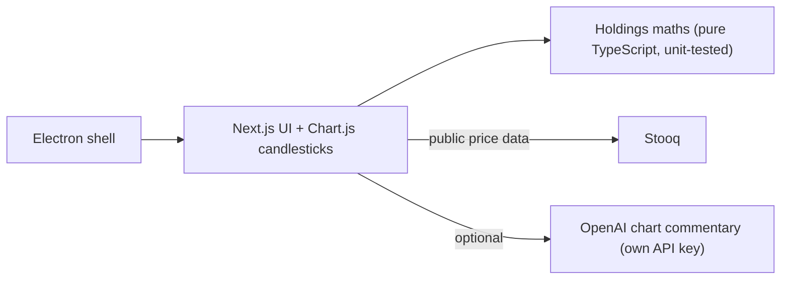

# Portfolio Insight: stock charts and holdings analysis

> Documentation only. The software is proprietary and its source is not published here. *Portfolio Insight is a working title.* **Not investment advice.**

**A dashboard that shows candlestick charts for Tokyo and US stocks next to your own holdings, with your portfolio data staying in your browser.**

## What it is designed to do
- Several candlestick charts at once, each with its own period and symbol; Tokyo and US tickers.
- A holdings view: positions, cash, market value, cost basis, unrealised gain/loss and allocation, computed from two JSON files you choose. The calculation runs in the browser; nothing is uploaded.
- Optional AI commentary on a chart through your own OpenAI API key (off unless configured).
- Runs as a web app (Next.js) or as a desktop app (Electron wraps the same app).
- The initial screen uses a **fictional** sample portfolio.

## Deliberately out of scope
Currency conversion, taxes, fees, dividends, realised gains, and any buy/sell recommendation. It describes and visualises holdings; it does not advise.

## How it is built

## Status (honest version)
| Verified | How |
|---|---|
| Holdings calculations | 3 unit tests pass |
| macOS installer builds | DMG/ZIP for Apple silicon produced |
| **Not verified** | |
| Live charts | In the most recent check the public price source (Stooq) could not be reached from the test machine, so the charts stayed empty. The app depends on a third-party endpoint that may change or stop |
| Launching the installer; Windows build | the build pipeline exists; not run on those systems |
| Market-data terms for commercial use | **unverified**. This is a demo until the data terms are cleared |
| Legal and sales terms | drafts only; no payment or licensing is connected |
| Interface language | currently Japanese only |

## Feedback wanted
**Tell me what is unclear, missing or wrong**: use the [feedback form](https://github.com/johnknash2025/portfolio-insight/issues/new?template=feedback.yml) or start a [discussion](https://github.com/johnknash2025/portfolio-insight/discussions). Useful questions: Would you use a holdings viewer that never uploads your data? Which markets and data sources matter to you? What would make you trust it?

Please do not post confidential or personal data, and do not share account or portfolio details.

Contact: coming soon. Source code can be shared when we discuss a project.

© johnkhappy. All rights reserved.
